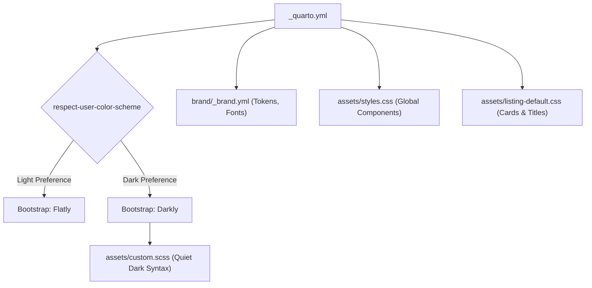

# Website Design Document: kutzen.org

## 1. Executive Summary & Design Vision

`kutzen.org` is the personal and academic web home of **Dalton Kutzen**, a molecular biology student and researcher at Brigham Young University working at the intersection of bacteriophage genomics, scientific software, and systems infrastructure.

As articulated in `VISION.md`, the site's central design idea is:
> **"Half polished portfolio and half poetry notebook, with room for the research and projects I love."**

The site is intentionally designed to reject the sterile conformity of a corporate resume or a LinkedIn clone. Instead, it balances rigorous technical and academic depth with genuine creative reflection. Visitors encounter a cohesive digital space where comparative genomics pipelines, Linux homelab infrastructure, essayistic blog posts, and creative writing naturally coexist.

## Document Status & Authority

This document defines the intended design direction for kutzen.org
and records implementation details supplied by the site owner.

It is not, by itself, evidence that every described feature is
implemented or that accessibility requirements have been verified.

### Established design decisions
- Clarity over flair.
- Creativity over trend following.
- A polished portfolio with the personal character of a poetry notebook.
- Flatly and Darkly as the theme foundations.
- The supplied color palette and typographic roles.
- Content-specific presentation within a coherent site identity.

### Implementation details to confirm
File paths, configuration options, installed extensions, navigation,
and component behavior should be checked against the repository
before making changes.

### Requirements to validate
Accessibility, responsive behavior, contrast, and interactive
functionality must be evaluated in the rendered site.

If the implementation differs from this document, report the
difference. Do not automatically rewrite the site or the document
to eliminate it.

---

## 2. Core Design Principles

The design of `kutzen.org` follows six foundational principles:

1. **Clarity Over Flair**: Information is easy to discover, read, and navigate. Layouts, visual effects, and typography serve readability and accessibility rather than ornamental distraction.
2. **Creativity Over Trend Following**: Visual and structural choices reflect Dalton's sensibilities, research domains, and creative writing rather than fleeting web design fads.
3. **Introduce, Then Invite Depth**: Key pages (such as Home, About, and Contact) offer immediate, welcoming orientations before inviting readers into deeper documentation, code repositories, or analytical writing.
4. **Show Passion Through Substance**: Technical authority is demonstrated through detailed project walkthroughs, reproducible code, and clear scientific explanations rather than self-promotional marketing copy.
5. **Preserve an Authentic Voice**: The tone across prose, technical documentation, and poetry remains personal, reflective, and human.
6. **Form Follows Content Type**: Research write-ups, code workflows, blog entries, and poems adopt tailored layouts and typographic treatments that best suit their nature while remaining unified under the site’s global brand.

---

## 3. Brand System & Visual Language

The website leverages Quarto's native **Brand System** (`brand/_brand.yml`) to define design tokens, color relationships, and typographic hierarchies.

### 3.1 Color Palette & Semantic Roles

The color system is anchored around a grounded, scientific dark-and-light aesthetic with vibrant accent hues:

| Token | Hex Value | Semantic Role | Description & Usage |
| :--- | :--- | :--- | :--- |
| `charcoal` | `#222222` | `background` | Deep, low-fatigue background in dark contexts |
| `white` | `#ffffff` | `foreground` | High-contrast text on dark surfaces |
| `navy` | `#375a7f` | `primary` | Navbar background and primary brand action tone |
| `gray` | `#444444` | `secondary` | Secondary borders, rules, and muted elements |
| `teal` | `#00bc8c` | `success` / `link` | Accent color, hyperlink color, and positive states |
| `blue` | `#3498db` | `info` | Informational highlights and secondary accents |
| `yellow` | `#f39c12` | `warning` | Warning tags and numerical highlights |
| `red` | `#e74c3c` | `danger` | Alerts, error states, and critical notices |
| `light-gray` | `#adb5bd` | `light` | Subtle borders, muted captions, and secondary text |
| `dark-gray` | `#303030` | `dark` | Card surfaces, container backgrounds, inline code fill |

#### Contextual Accent Shifts (Light vs. Dark Mode)
To ensure optimal WCAG AA contrast across color modes:
- **Light Mode (`Flatly`)**:
  - Surface: `#f5f7f8`
  - Border: `#dce3e7`
  - Primary Text: `#263746`
  - Muted Text: `#52616d`
  - Accent / Links: Deep Teal (`#087c65`)
- **Dark Mode (`Darkly`)**:
  - Surface: `#292929`
  - Border: `#454545`
  - Primary Text: `#eeeeee`
  - Muted Text: `#c1c5c9`
  - Accent / Links: Bright Seafoam Teal (`#7ee2c0`)

### 3.2 Typography

Typography is loaded via Google Fonts and structured in `brand/_brand.yml`:

- **Headings (`h1`–`h6`)**: **Raleway** (weights 500 & 600)
  - Geometric yet humanist sans-serif with distinct character, conveying academic precision without severity.
- **Body / Prose**: **Nunito** (size: `1rem`, line-height: `1.6`)
  - Warm, rounded sans-serif that ensures high legibility across long-form reading.
- **Monospace & Code**: **IBM Plex Mono** (size: `0.9em`, weight 400, line-height: `1.5`)
  - Industrial, clear monospace face tailored for scientific workflows, command-line examples, and bioinformatic scripts.
- **Poetry Display**: **Georgia / Times New Roman** (size: `clamp(1.05rem, 1.2rem)`, line-height: `1.85`)
  - Classical serif face reserved exclusively for poetry stanzas (`.poem`), establishing an immediate tactile shift into notebook mode.

---

## 4. Theme Engine & Custom Styling

The styling architecture is modular, combining Quarto's Bootstrap integration with custom SCSS and CSS layers:



### 4.1 Theme Architecture (`_quarto.yml`)
- **Light Theme**: `flatly` (clean, flat modern Bootstrap theme).
- **Dark Theme**: `darkly` complemented by `assets/custom.scss`.
- **Automatic Switching**: `respect-user-color-scheme: true` seamlessly honors the visitor's OS or browser setting.

### 4.2 Quiet Dark Syntax Highlighting (`assets/custom.scss`)
Code syntax styling in dark mode replaces jarring, oversaturated token colors with a tailored, soft palette designed specifically for a `#1b1b1b` code-block background:
- **Comments (`.co`, `.do`)**: `#b0b6bd` (muted silver)
- **Keywords & Control Flow (`.kw`, `.cf`, `.im`)**: `#d4bfff` (soft lavender)
- **Strings (`.st`, `.vs`)**: `#c0dfa0` (pale sage)
- **Numbers & Constants (`.dv`, `.cn`)**: `#f0c291` (warm peach)
- **Functions & Built-ins (`.fu`, `.bu`)**: `#a6d5fa` (ice blue)
- **Types & Attributes (`.dt`, `.at`)**: `#9eddd4` (soft turquoise)
- **Inline Code**: Foreground `#7ee2c0`, Background `#303030`, padded with rounded corners.

### 4.3 Code Block Usability
- Code blocks include line numbering (`code-line-numbers: true`).
- Horizontal scrolling for wide genomic pipelines and shell scripts (`code-overflow: scroll`).
- Copy-to-clipboard on hover (`code-copy: hover`).
- Code folding enabled by default with toggle visibility (`code-fold: show`).

---

## 5. Information Architecture & Navigation

The site is organized into clear top-level entry points via a sticky, primary-colored top navigation bar, supported by a structured footer.

```
kutzen.org/
├── index.qmd               # Landing page (Jolla introduction)
├── about.qmd               # Comprehensive background, philosophy & skills
├── projects/
│   └── index.qmd           # Computational biology, workflows & tools
├── blog/
│   ├── index.qmd           # "Reading Frames" publication & RSS feed
│   ├── 2026-10_.../        # Scientific workflow design
│   └── 2026-10_.../        # Homelab and infrastructure essays
├── cv.qmd                  # Résumé & Academic CV downloads
├── contact.qmd             # Direct communication channels & issue reporting
├── poem.qmd                # Creative writing & poetry showcase
├── accessibility.qmd       # Accessibility commitment & feedback loop
├── license.qmd             # CC BY-SA 4.0 creative commons licensing
└── 404.qmd                 # Custom error page
```

### 5.1 Primary Navigation Bar
- **Branding**: Title link (`Dalton Kutzen`) leading to root.
- **Search**: Built-in client-side full-text search (`search: true`).
- **Links (Right)**:
  - `Home`: Brief personal introduction and research focus.
  - `About`: Detailed narrative on biology, software, systems, and interests.
  - `Projects`: Directory of tools (Phantom, genome visualizers, infrastructure).
  - `Blog`: Technical articles, essays, and notes under the title *"Reading Frames"*.
  - `CV`: Downloadable résumé and academic curriculum vitae.
  - `Contact`: Direct contact methods, collaboration notes, and GitHub issue tracker.
- **Tools**: GitHub icon linking directly to the open-source repository `DKutzen22/kutzen.org`.

### 5.2 Global Page Footer
The footer provides secondary discovery and formal attribution:
- **Left**: Copyright stamp (`© 2026 Dalton Kutzen · Made with Quarto`).
- **Center**: Social and academic icon links rendered with FontAwesome (`fa`) and Academicons (`ai`):
  - Accessibility (`fa universal-access`)
  - LinkedIn (`fa brands linkedin`)
  - GitHub (`fa brands github`)
  - ORCID (`ai orcid` — `0009-0009-2643-8127`)
  - Google Scholar (`ai google-scholar` — `CIkLbu4AAAAJ`)
- **Right**: Accessibility statement link, Contact form link, Creative Commons License, and RSS feed (`blog.xml`).

---

## 6. Page Templates & Layout Archetypes

The site employs specialized layout patterns tailored to the distinct intent of each section:

### 6.1 The "Jolla" Persona Hero (`index.qmd`, `contact.qmd`)
- **Quarto Template**: `about: template: jolla`
- **Visual Structure**: Centered circular portrait (`image-shape: round`, `image-width: 17em`), concise bio, and direct action pills (LinkedIn, GitHub, Email).
- **Purpose**: Establishes an immediate, warm human connection without cognitive overload.

### 6.2 The Modular About Page (`about.qmd`)
- **Layout**: Custom full-width container (`max-width: 1080px`) with scoped responsive CSS.
- **Hero Eyebrow**: Uppercase badge (`Biology · Software · Systems`).
- **Card Grid System (`.about-grid`)**: Two-column responsive card layout (`repeat(2, minmax(0, 1fr))` collapsing to 1-column on screens $\le 760\text{px}$).
- **Callout Notes (`.about-note`)**: Border-left highlighted quote panels (`border-left: 3px solid var(--about-accent)`) for core research and learning philosophies.
- **Structured Taxonomy**: Clearly separates bioinformatics/genomics, programming/data analysis, research software reproducibility, and systems/homelab infrastructure.

### 6.3 The Blog: "Reading Frames" (`blog/index.qmd`)
- **Biological Metaphor**: The title *Reading Frames* connects molecular biology's open reading frames with intellectual perspectives and writing.
- **Listing Structure**:
  - Default layout with right-aligned thumbnail images.
  - Metadata displaying title, date, author, and categories.
  - Integrated RSS/Atom feed generation (`blog.xml`).
  - Styled listing cards with transparent backgrounds, subtle borders, and rounded thumbnail edges (`assets/listing-default.css`).

### 6.4 The Poetry Notebook (`poem.qmd`, `.poem`)
- **Layout**: Centered, narrow measure (`max-width: 42rem`, generous top/bottom margins).
- **Typography**: Serif typeface (Georgia / Times New Roman), fluid sizing (`clamp(1.05rem, 1.2rem)`), line-height `1.85`.
- **Stanza Rhythm**: Pandoc line-blocks (`|`) rendered with dedicated stanza margins (`.line-block { margin-block: 0 1.6em; }`), evoking an intimate printed literary journal.

### 6.5 The Academic & Professional Hub (`cv.qmd`)
- **Action Buttons**: Direct download pills for both **One-page Résumé** (`Dalton_Kutzen-Resume.pdf`) and **Academic Curriculum Vitae** (`Dalton_Kutzen-CV.pdf`).
- **Clear Demarcation**: Explicitly differentiates between an industry-focused summary and a complete academic record.

---

## 7. Accessibility, Inclusivity & Web Standards

Accessibility is a first-class architectural requirement across the site:

1. **Automated Auditing**: `axe: true` is configured in `_quarto.yml`, continuously evaluating pages against axe-core accessibility rules during development and build.
2. **Keyboard Navigation & Focus**: All interactive elements (navbar items, footer links, action buttons) have explicit `:focus-visible` outlines (`2px solid currentColor` with offset).
3. **Contrast Compliance**: Light and dark themes maintain WCAG AA contrast standards across body text, headings, muted captions, and code spans.
4. **Descriptive Link Texts & Labels**: Links provide descriptive text and `aria-label` tags for screen readers (e.g., RSS, GitHub, Accessibility Commitment).
5. **Transparency & Reporting**: `accessibility.qmd` openly states the site's current accessibility posture and provides a direct GitHub issue link for reporting digital barriers.

---

## 8. Integrated Extensions & Scientific Tooling

The site incorporates specialized Quarto extensions to enable interactive scientific documentation:

| Extension | Source | Capability & Use Case |
| :--- | :--- | :--- |
| `fontawesome` | `quarto-ext/fontawesome` | Standard web iconography and social badges |
| `academicons` | `schochastics/academicons` | Scholarly profile badges (ORCID, Google Scholar) |
| `molstar` | `jmbuhr/molstar` | Interactive in-browser 3D macromolecular structures (phage capsids, proteins) |
| `pyodide` | `coatless-quarto/pyodide` | Client-side Python execution in computational blog posts |
| `git-sandbox` | `ryjohnson09/git-sandbox` | Interactive Git environment demonstrations |
| `diagrams` | `EmilHvitfeldt/diagrams` | Workflow and pipeline graph visualizations |
| `timeline` | `EmilHvitfeldt/timeline` | Visual milestone and project timeline rendering |

---

## 9. Summary Comparison: Old Setup vs. Current Design

| Dimension | Previous Inherited Setup | Current `kutzen.org` Design |
| :--- | :--- | :--- |
| **Site Identity** | Forestry / Wildfire GIS portfolio | Molecular biology, phage genomics, scientific tools & poetry |
| **Color System** | External SCSS overrides & hardcoded hexes | Unified Quarto Brand YAML (`brand/_brand.yml`) + Flatly/Darkly |
| **Dark Theme** | Heavy dark palette | Tailored Darkly with custom "Quiet Dark" code token syntax |
| **Typography** | Default bootstrap sans | Raleway (headings) + Nunito (body) + IBM Plex Mono (code) |
| **Poetry & Creative** | None | Dedicated serif poetry layouts (`.poem`) and literary notebook feel |
| **Blog Identity** | Standard tech blog | *Reading Frames* with biological metaphor and clean card listing |
| **CV / Résumé** | Auto-rendered HTML listing | Clean PDF download portal distinguishing Résumé from Academic CV |
| **Accessibility** | Unmonitored | Integrated Axe checks (`axe: true`) and dedicated policy page |
